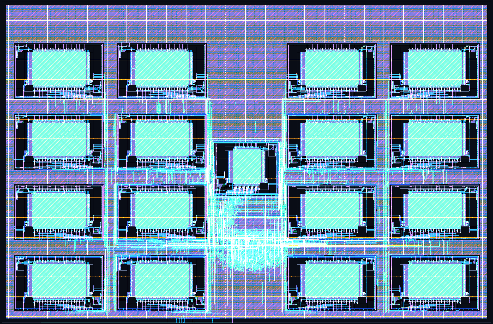
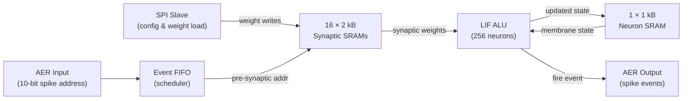

# TinyODIN — Sky130A Neuromorphic SNN Chip

> A 256-neuron / 64k-synapse **Spiking Neural Network (SNN)** processor implemented in **SkyWater Sky130A** open-source PDK using **OpenLane 2 / librelane**.  
> Die size: **3.80 × 2.50 mm** · Clock: **20 MHz** · 0 DRC · LVS clean · Timing closed.

---

## Chip Layout 



---

## Repository Structure

```
tinyodin-sky130-vlsi/
├── rtl/              # Synthesisable Verilog RTL (9 modules)
├── macros/           # OpenRAM SRAM macros — LEF, LIB, GDS, black-box .v
│   ├── lef/
│   ├── lib/
│   └── gds/
├── openlane/         # OpenLane 2 config (relative dir:: paths) + SDC
├── gds/              # Final layout — tinyODIN.klayout.gds.gz  (~9 MB gzip)
├── docs/             # Die plot (IEEE style)
├── signoff/          # Signoff reports: DRC, LVS, STA, antenna, IR drop
└── Makefile          # make build | make view | make clean
```

---

## Quick Start

### Prerequisites

| Tool | Version |
|------|---------|
| [librelane](https://github.com/efabless/openlane2) | ≥ 2.x (Docker) |
| KLayout | ≥ 0.28 |
| Sky130A PDK | via [volare](https://github.com/efabless/volare) |

> **RAM:** The flow is configured for a ≤ 9 GB RAM cap (KLayout streamout, no Magic GDS).

### Build

```bash
git clone https://github.com/<your-org>/tinyodin-sky130-vlsi.git
cd tinyodin-sky130-vlsi
make build        # runs OpenLane 2 — produces runs/
```

### View GDS

```bash
make view         # decompresses gds/tinyODIN.klayout.gds.gz → opens KLayout
```

---

## Architecture

TinyODIN is a **leaky integrate-and-fire (LIF)** digital SNN processor with:

| Resource | Count | Memory |
|----------|-------|--------|
| Neurons | 256 | 1 × 1 kB neuron SRAM |
| Synapses | 65 536 (256×256) | 16 × 2 kB synaptic SRAMs |
| AER output | 10-bit address bus | — |
| SPI config | 4-wire slave | — |

### Spike Data-Flow



---

## Floorplan & Block Placement

Die: **3800 × 2500 µm** · Core: **3740 × 2440 µm** (30 µm margins)

| Block | Instances | Location (µm) | Orientation | Description |
|-------|-----------|----------------|-------------|-------------|
| **Left SRAM Wing** | Banks 0–1, 4–5, 8–9, 12–13 | X: 100–1700, Y: 100–2250 | FN (flipped) | 8 × 2 kB synaptic SRAMs |
| **Right SRAM Wing** | Banks 2–3, 6–7, 10–11, 14–15 | X: 2220–3820, Y: 100–2250 | N (normal) | 8 × 2 kB synaptic SRAMs |
| **Central Neuron SRAM** | `neurarray_0.sram_inst` | X: 1660, Y: 1000 | N | 1 × 1 kB neuron state SRAM |
| **Digital SNN Spine** | Standard cells | X: 1700–2220 (central corridor) | — | LIF ALU, scheduler, SPI, AER ctrl |

> The two SRAM wings face each other (FN/N orientation pair) to minimise routing distance to the central control spine.

---

## Signoff Summary

| Check | Result | Detail |
|-------|--------|--------|
| **DRC (KLayout)** | ✅ **0 violations** | 249 rules checked, all clean |
| **LVS (Netgen)** | ✅ **Circuits match** | Full schematic ↔ layout equivalence |
| **Setup timing** | ✅ **0 violations** | Worst slack: +0.56 ns (ss corner, 20 MHz) |
| **Hold timing** | ✅ **0 violations** | Worst slack: +0.12 ns (ff corner) |
| **IR drop (VPWR)** | ✅ **0.10%** | 1.73 mV worst-case on 1.80 V |
| **IR drop (VGND)** | ✅ **0.11%** | 1.93 mV ground bounce |
| **Antenna** | ⚠️ **16 pin violations** | 14 nets; ratios 1.01×–1.59× limit on met1–met5 near SRAM buses. Marginal; acceptable for academic / MPW tape-out. See [`signoff/antenna_summary.rpt`](signoff/antenna_summary.rpt) |
| **Max slew / cap** | ⚠️ **3182 / 373** | Corner-only violations at ss 100°C 1.60 V. Nominal corner is clean. |

> Full reports in [`signoff/`](signoff/).

---

## RTL Modules

| File | Description |
|------|-------------|
| `rtl/tinyODIN.v` | Top-level integration |
| `rtl/controller.v` | SNN control FSM |
| `rtl/lif_neuron.v` | LIF integrate-and-fire ALU |
| `rtl/neuron_core.v` | Neuron array + SRAM interface |
| `rtl/synaptic_core.v` | Synaptic array + SRAM banks |
| `rtl/aer_out.v` | AER output event encoder |
| `rtl/scheduler.v` | Input event FIFO scheduler |
| `rtl/spi_slave.v` | SPI configuration slave |
| `rtl/fifo.v` | Generic synchronous FIFO |

---

## Citation

If you use this design in your research, please cite:

```bibtex
@article{frenkel2019odin,
  title   = {A 0.086-mm² 12.7-pJ/SOP 64k-Synapse 256-Neuron Online-Learning
             Digital Spiking Neuromorphic Processor in 28-nm CMOS},
  author  = {Frenkel, Charlotte and Lefebvre, Martin and Legat, Jean-Didier
             and Bol, David},
  journal = {IEEE Transactions on Biomedical Circuits and Systems},
  volume  = {13},
  number  = {1},
  pages   = {145--158},
  year    = {2019}
}
```

---

## License

RTL source code: [Apache 2.0](LICENSE)  
Sky130 PDK macros: [Apache 2.0](https://github.com/google/skywater-pdk)
